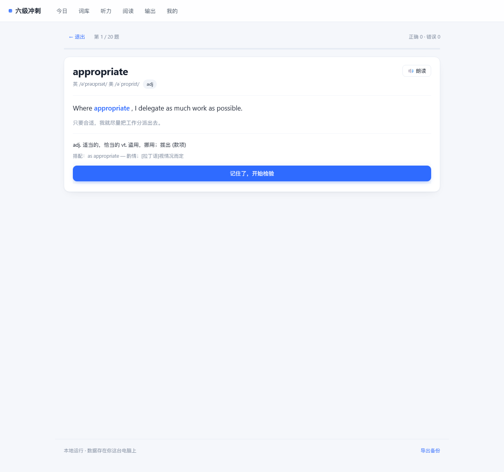
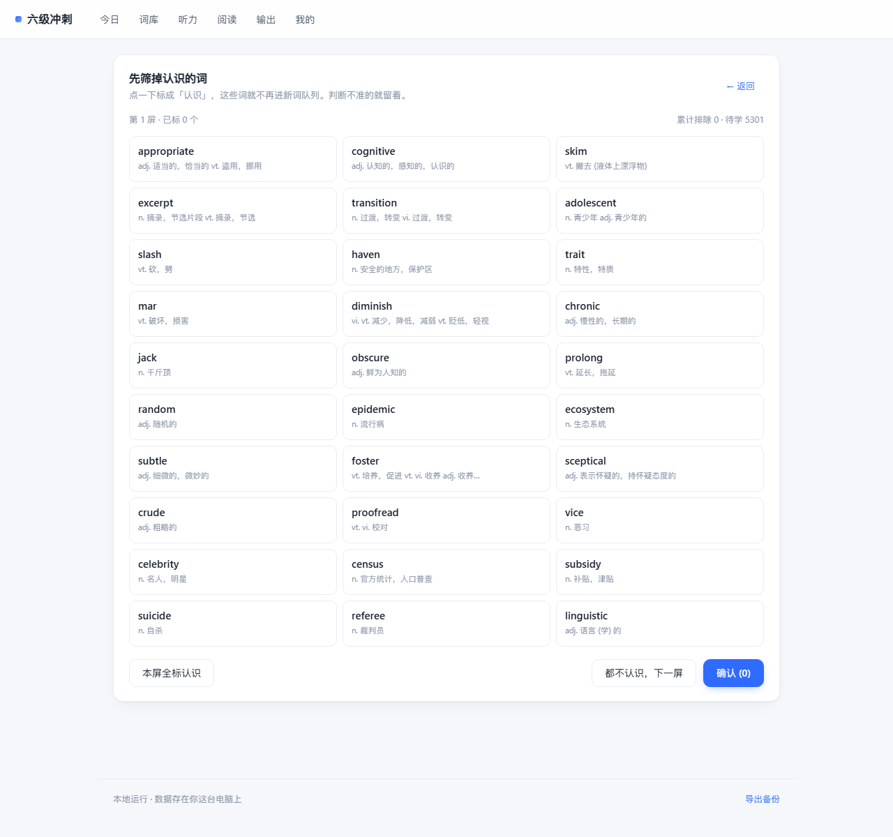
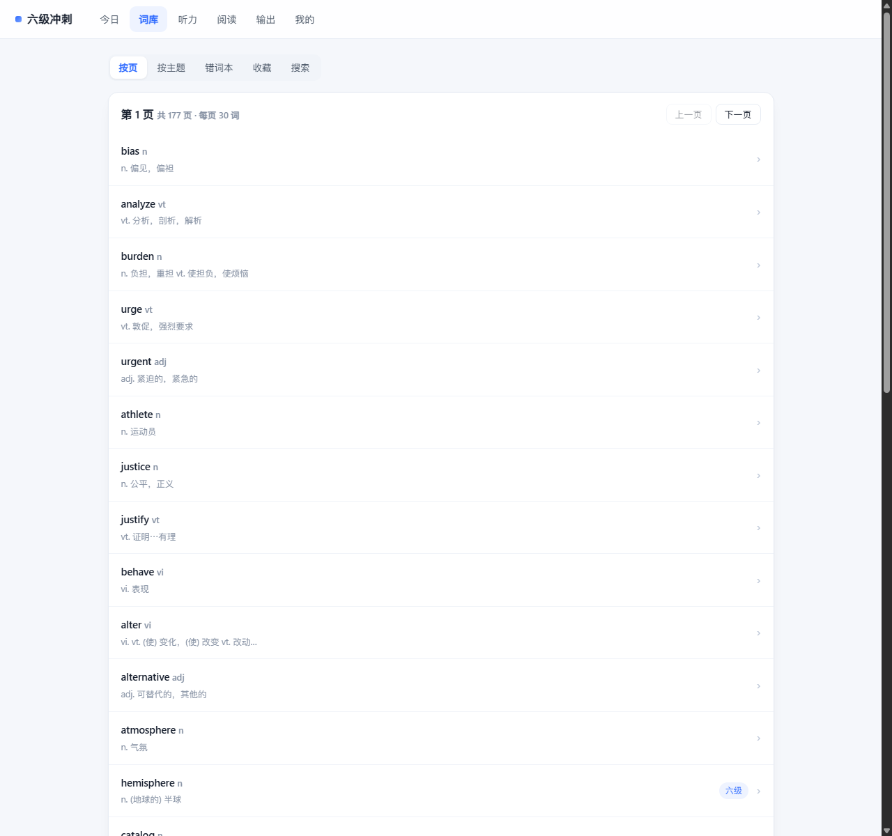
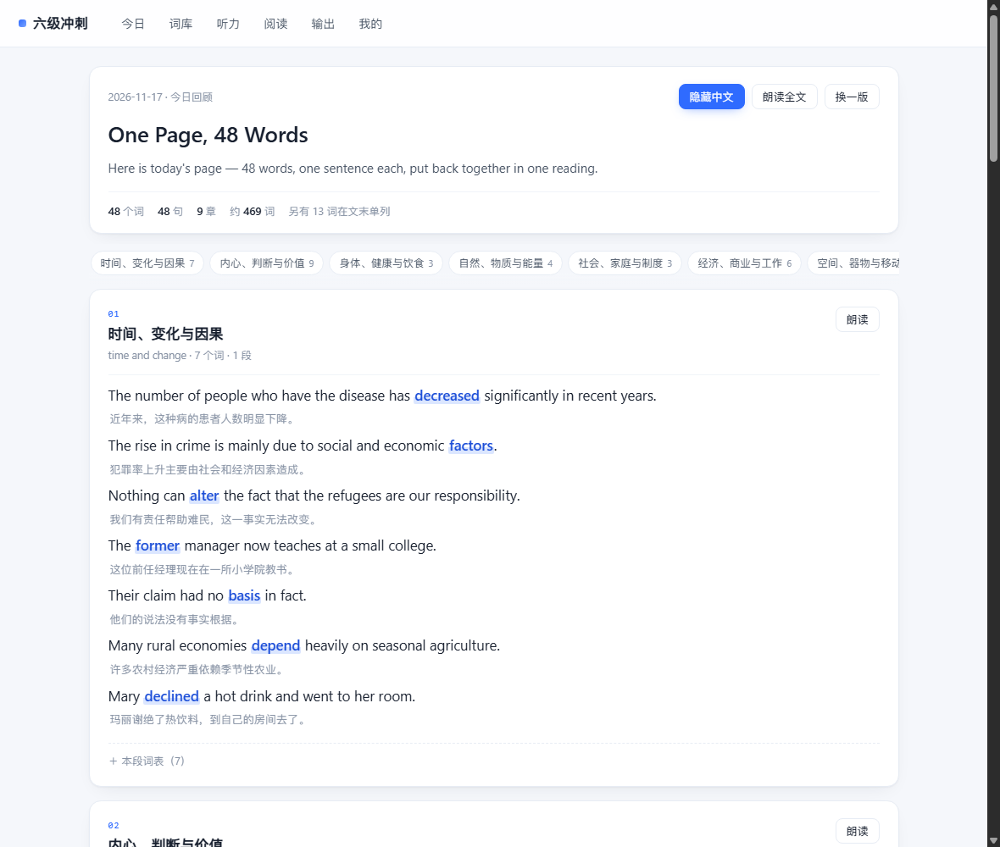
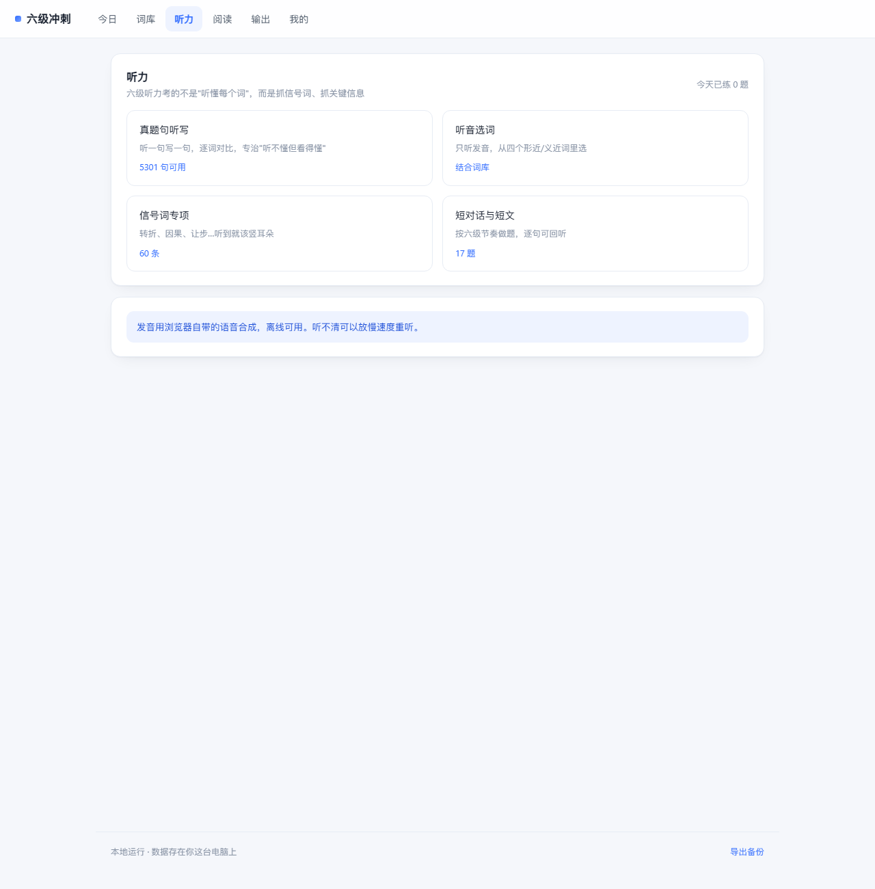
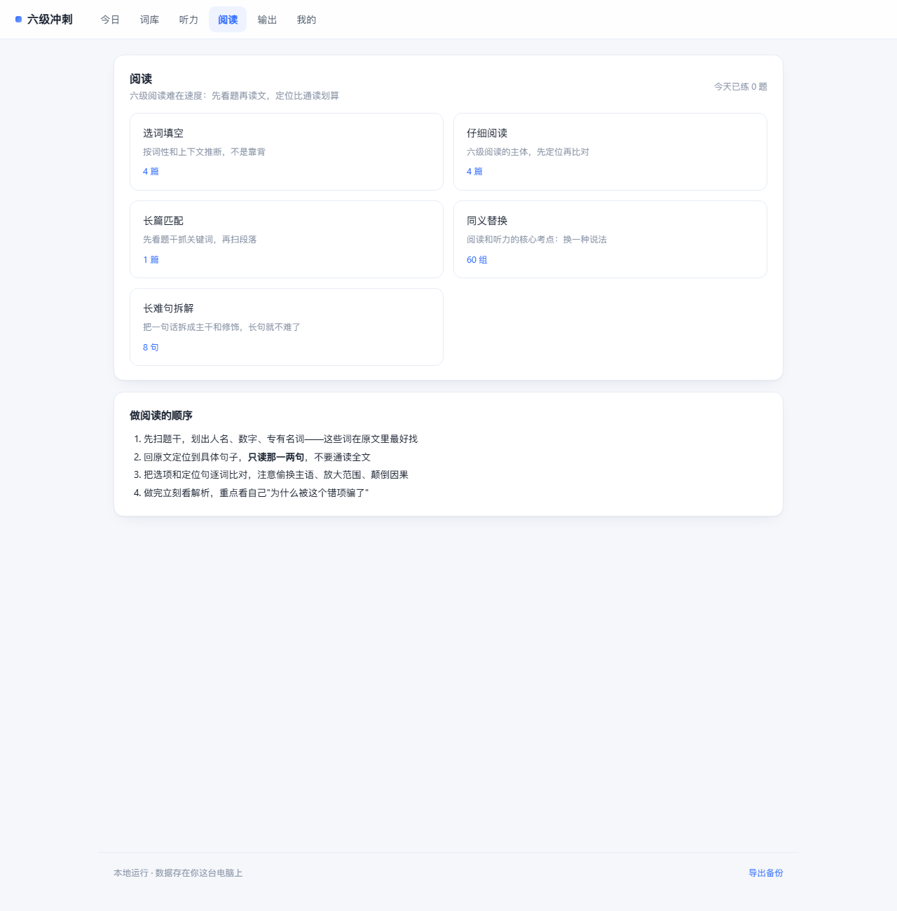
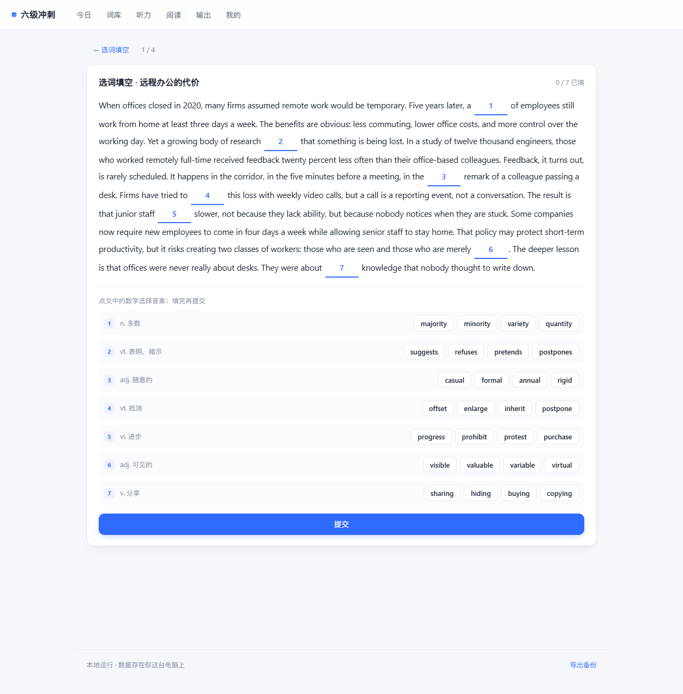
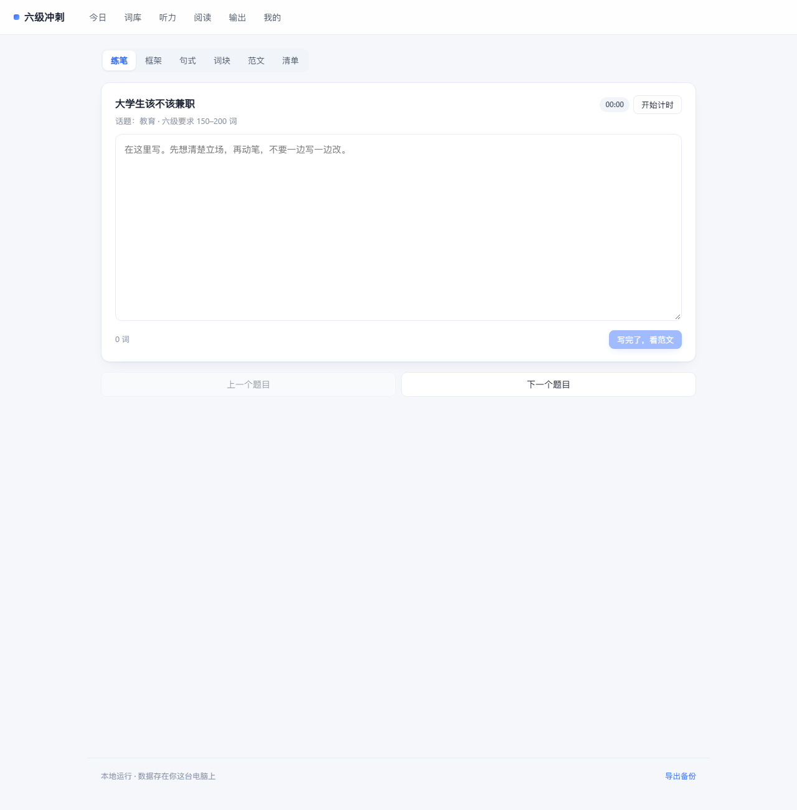
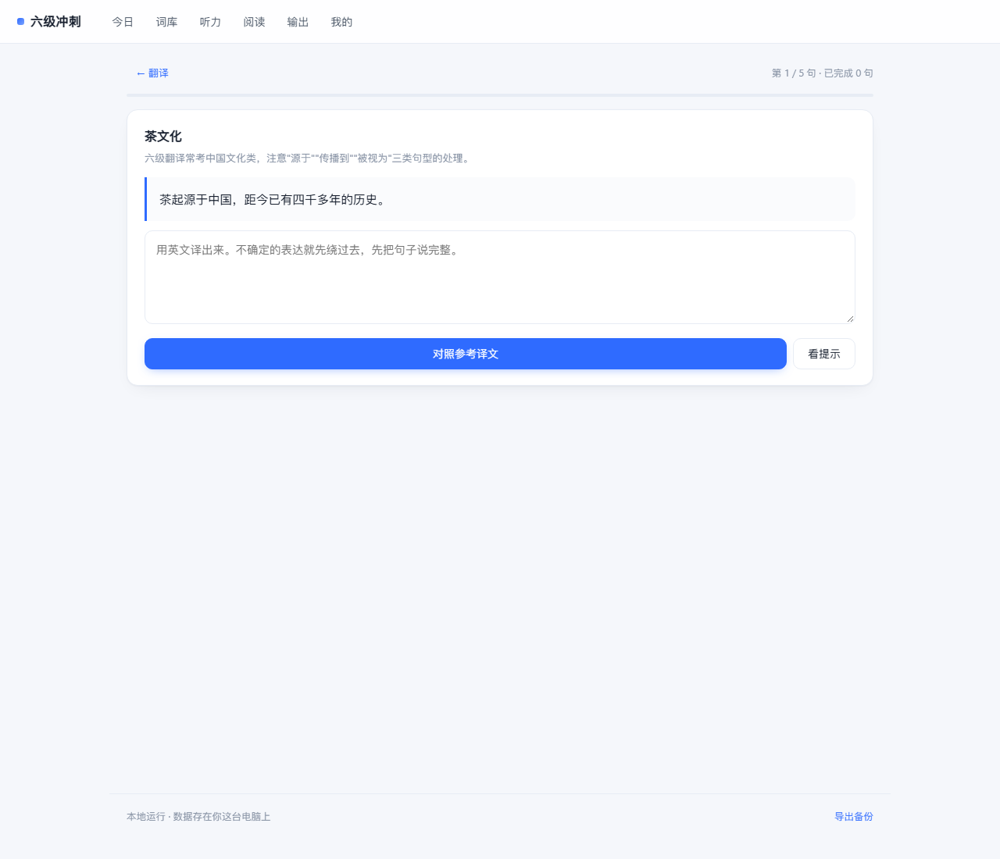
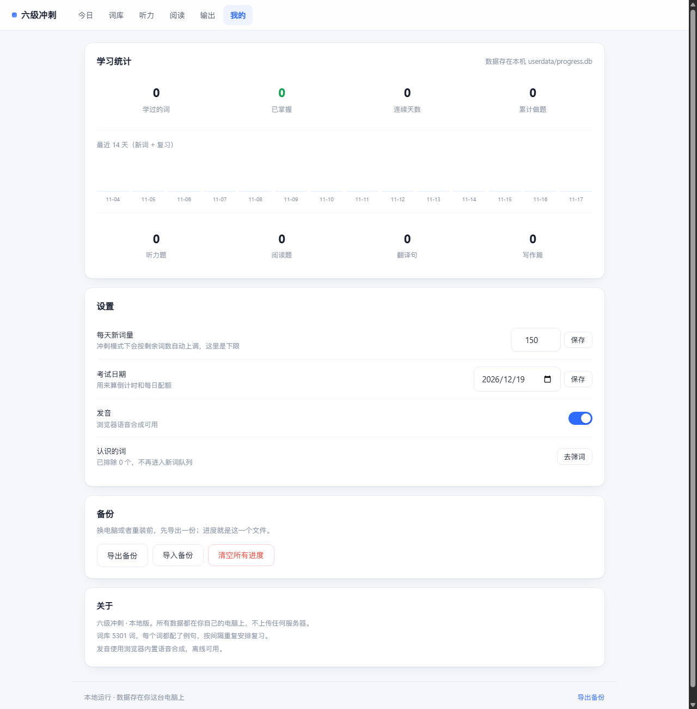

# 六级冲刺 · 本地版

一个跑在自己电脑上的英语六级备考工具。5301 个六级词，**不孤立背单词，每个词都放进句子里理解**；外带听力、阅读、写作、翻译四个模块的专项练习。

不需要注册、不需要联网、不需要装依赖。clone 下来双击启动，浏览器里就能用。


## 快速开始

需要 Python 3.9 或更高版本（[官网下载](https://www.python.org/downloads/)，Windows 安装时记得勾选 `Add Python to PATH`）。

```bash
git clone https://github.com/mwth666/cet6-app.git
cd cet6-app
```

不想装 Git 也行：打开 [github.com/mwth666/cet6-app](https://github.com/mwth666/cet6-app)，点绿色 `Code` → `Download ZIP`，解压后进目录，同样双击启动。

**Windows**：双击 `start.bat`

**macOS**：双击 `start.command`（首次若提示无法打开，右键 → 打开；或在终端执行 `chmod +x start.command`）

**Linux / 终端**：`./start.sh`

或者一条命令，三个平台通用：

```bash
python server.py
```

浏览器会自动打开 `http://127.0.0.1:8765/`。关掉终端窗口或者按 `Ctrl+C` 就停止。

> 端口 8765 被占用时会自动往后找（8766、8767…），启动时打印的地址为准。

## 每天怎么用

首页只有一件事要你做：**完成今日任务**。

30 天倒计时环里写着今天的分母：新词 166 个 + 待复习的词。点进去就是一轮一轮的练习，做完自动记录，不用手动打卡。

| 时间 | 做什么 | 在哪 |
|---|---|---|
| 20 分钟 | 今日任务：新词 + 复习，自动排好，一题一题过 | 今日 |
| 10 分钟 | 快速筛词：一屏 30 个词，认识的直接划掉 | 词汇 → 快速筛词 |
| 15 分钟 | 一个专项：听力 / 阅读 / 写作 / 翻译任选 | 对应 tab |
| 8 分钟 | **回顾长文**：把今天背过的词连成一篇读一遍 | 今日 → 今日回顾 |
| 5 分钟 | 看统计，确认今天有没有断 | 我的 |

## 背单词这块是怎么设计的

单词表背单词最大的问题是：**认得脸，用不出来**。看着 `abandon` 知道是「放弃」，但写作文时想不起来，听力里听不出来，阅读里换个搭配就懵了。

所以这个工具的做法是：**同一个词，用 4 种不同的方式让你碰 4 次**，每次都在句子里。



### 七种题型，按记忆阶段自动切换

| 题型 | 长什么样 | 练的是 |
|---|---|---|
| 语境挖空 | `They had to ____ the plan.` 选 abandon | 从上下文推断词义 |
| 句中猜义 | 给整句，问划线的词什么意思 | 阅读时的猜词能力 |
| 听音辨词 | 只放音，从四个形近/义近词里选 | 听力辨识 |
| 汉译英填空 | 根据中文和首字母拼出单词 | 主动回忆（最难，最有效） |
| 拼写 | 听音写词，逐字母对比 | 写作时的准确拼写 |
| 形近词辨析 | `adapt / adopt / adept` 放一起 | 避免混词 |
| 词块模式 | `____ ship 弃船`，填 abandon | 搭配和用法 |

新词第一次出现一定先给「语境 + 释义」的介绍卡，不会一上来就考你。答对答错按耗时自动判 0–3 级，答得快算「秒懂」，答错算「忘了」。

### 间隔重复：改良版 SM-2

- **学习阶段**：10 分钟 → 1 天 → 3 天，连续答对才毕业
- **复习阶段**：按 ease 因子放大间隔，答错立刻回到 10 分钟
- **冲刺模式**：间隔上限压到 10 天（默认开启），保证考前每个词至少过 3 轮

每天的新词量不是写死的。**按「剩余词数 ÷ 剩余天数」自动算**，所以：

- 剩 32 天、5301 词 → 每天 166 个
- 剩 10 天、只剩 800 词 → 每天 80 个
- 全背完了 → 自动变成 0，只推送复习

设置页里的「每天新词量」是**下限**，不是上限。

### 快速筛词：30 秒排掉 30 个



六级词汇里大概有一半你已经认识了。一屏 30 个词，认识的直接点掉，闪一下释义自动跳下一个。**筛掉的词不再进新词队列**，省下的时间全给生词。

误点了可以撤销。



词库页还能按页翻（和纸质书对得上）、按主题看、查错词本和收藏，也能直接搜中英文。

### 背完之后：把今天的词连成一篇长文再读一遍

背完当天的词，首页会多出一个「今日回顾」入口。点进去是一篇长文：**今天背过的每个词，都用它自己的例句再出现一次**。


词库里的每个词本来就带着一条完整的例句。与其把这些句子只用来做题，不如按主题把它们重新排成一篇——同一个主题的词集中在一章里，一章读下来就是一串彼此相关的语境：

```
01 时间、变化与因果  time and change
The number of people who have the disease has decreased significantly in recent years.
The rise in crime is mainly due to social and economic factors.
Nothing can alter the fact that the refugees are our responsibility.
...
```

读的时候有几件事可以做：

- **点高亮的词**，就地弹出释义和发音，不用跳走
- **显示中文**：每句下面出现例句译文，先读英文、想不起来再看
- **朗读全文 / 朗读本章**：逐句念，念到哪句哪句就亮起来，适合通勤时闭着眼睛过一遍
- **换一版**：同样的词换个顺序、换种分章，再读一遍

同一天、同一版，**刷新多少次都是同一篇**。所以第二天想起来还能翻回去重读，不会每次打开都是新东西。



#### 说清楚它是怎么来的

这篇长文不是 AI 写的故事，**每一句都是词库里该词自带的真实例句**，我只做了四件事：按主题分章、给句子排序、切段、挑标题。排序用的是「共享实词串链」——下一句总挑和最近两句有共同实词的那句，同一个人、同一个场景的句子就会挨在一起；找不到重叠时退回原顺序。所以它读起来更像「把今天的词放回各自的语境里过一遍」，而不是一篇有情节的散文——语义上的跳跃是真实存在的，我没有用连接词去硬粘，因为那会造出假的因果关系，也容易写出语法错的句子。

对记忆来说这恰好是够用的：一个词在不同位置重复遇见四次，比在一个编造的故事里被生硬地用一次更有效。

有两类词进不了正文：例句是短语片段的（`a formula for settling a dispute` 这种，没有主语和句末标点），以及例句和别的词撞车的。它们不会丢，统一列在文末「没进正文的词」里，照样能点开看。166 个词的正常一天，大约 150 个进正文、十几条进补列。

## 另外四个模块

### 听力



六级听力考的不是「听懂每个词」，是抓信号词、抓关键信息。四种练法：

- **真题句听写**：520 句真题原文，听一句写一句，逐词对比标出听错的位置
- **听音选词**：只放音不显示文字，从四个形近/义近词里选
- **信号词专项**：60 条，按转折、因果、让步、举例、强调、时间分类。听到 `but` / `however` / `in fact` 后面才是答案，这是听力提分最快的一项
- **短对话与短文**：6 段，可逐句回听、中英对照、带解析

### 阅读



- **选词填空** 4 篇：点文中的空格填词，按词性和上下文推断，不是靠背
- **仔细阅读** 4 篇：原文和题目并排，先定位再比对
- **长篇匹配** 1 篇：8 段 8 句，段落连线
- **同义替换** 60 组：阅读的核心考点就是「换一种说法」，这 60 组是高频替换对
- **长难句拆解** 8 句：把一句话拆成主干和修饰，逐块标注成分



### 写作



30 分钟计时 + 实时词数 + 自动存草稿。写完对照同题范文，范文是**逐段批注**的——这段为什么这么开头、哪个句式可以抄走。最后用四维清单自评（内容 / 结构 / 语言 / 长度）。

资料区还有：3 个作文框架、30 个高分句式、8 个主题共 80 个词块、4 篇带批注范文。

不提供 AI 打分。理由很简单：机器打分的反馈你看了也不会改，**对照范文自己找差距更有效**。

### 翻译



6 个主题（茶文化、城市化、教育公平等，都是六级常考方向），每篇 5 句。**一句一句翻**，不要整段一次性翻。写完对照参考译文、关键短语和考点提示。

进度自动记住，下次接着翻。另有 59 条高频表达可搜索，都是固定说法，背下来直接用。

## 数据在哪

全部在你自己电脑上：

```
userdata/progress.db        SQLite，学习进度就是这一个文件
```

不上传任何服务器，不联网（除了你打开的那个本地端口）。

- **换电脑 / 重装**：我的 → 导出备份，拿到一个 JSON；新机器上「导入备份」即可
- **想从头开始**：我的 → 清空所有进度
- **想手动看**：`progress.db` 是标准 SQLite，两张表 `srs`（每词一条 JSON）和 `kv`（其他状态）



统计页能看到累计学过多少词、掌握多少、连续天数，以及最近 14 天的柱状图；下面还能改每天新词量、考试日期、开关发音。

`userdata/` 已在 `.gitignore` 里，不会误提交。

## 技术说明

### 为什么用「Python 标准库 + 原生 JS」

没有 npm、没有构建、没有 `pip install`。理由很实际：**别人 clone 下来要能立刻跑起来**，而环境问题是最容易劝退的一步。

- 后端：`http.server` 的 `ThreadingHTTPServer` + `sqlite3`，425 行
- 前端：原生 ES5 语法 + 手写 hash 路由，零框架
- 发音：浏览器内置 `speechSynthesis`，离线可用；不支持的浏览器自动静音，其余功能不受影响
- 全量代码约 5000 行，其中包含完整注释

### 数据怎么传

词库 1.8MB，不可能每次全量传：

- `GET /api/state` 启动时拉一次全量进度
- `POST /api/patch` 之后只上报**改动的部分**，按词 upsert
- 页面隐藏 / 关闭时 `flushSync` 兜底，不丢数据
- 静态资源带 ETag，改完刷新即生效

### 目录结构

```
cet6-app/
├── server.py                  后端（HTTP + SQLite），零依赖
├── start.bat / .command / .sh 三个平台的启动脚本
├── data/
│   ├── words.json             5301 词，含例句、音标、词块
│   └── content/               听力/阅读/写作/翻译的题目数据
├── web/
│   ├── index.html             单页外壳
│   ├── css/app.css            全部样式（手写设计系统，约 740 行）
│   └── js/
│       ├── core.js            fetch 封装、hash 路由、工具函数
│       ├── config.js          配额、考试日期、冲刺模式开关
│       ├── words.js           词库加载与索引
│       ├── store.js           进度状态机 + 增量同步
│       ├── srs.js             间隔重复算法（纯函数）
│       ├── quiz.js            七种题型的生成与判分
│       ├── queue.js           每日取词队列
│       ├── article.js         回顾长文的生成器（分章、编排、确定性随机）
│       ├── audio.js           发音（Web Speech + 逐句朗读队列）
│       ├── boot.js            启动与首屏
│       └── views/             12 个页面视图
├── userdata/                  你的进度（不进仓库）
└── docs/screenshots/          README 用的截图
```

### 换成自己的词库

`data/words.json` 就是一个 JSON 数组，字段说明见 [ATTRIBUTION.md](ATTRIBUTION.md#如何换成自己的词库)。换成考研词、托福词、你自己的生词本都行，**代码一行不用改**。

唯一硬要求：`i` 字段从 0 连续递增，因为学习进度用它做索引。

## 内容量

| 模块 | 数量 |
|---|---|
| 词库 | 5301 词，每词配例句（真题 520 + 开源数据集 3235 + 769 + 自建 777），2674 词另有常用搭配 |
| 听力 | 520 句真题听写、60 条信号词、6 段对话短文共 17 题 |
| 阅读 | 4 篇选词填空、4 篇仔细阅读、1 篇长篇匹配、60 组同义替换、8 个长难句 |
| 写作 | 3 个框架、30 个句式、80 个词块、4 篇批注范文、4 维自评清单 |
| 翻译 | 6 篇主题翻译（30 句）、59 条高频表达 |

所有练习题与解析均为原创，按六级题型结构重写，非真题原文。

## 怎么确认它没坏

改过代码之后（或者 fork 之后想验证一下），跑三个脚本就行。都只用 Node 和 Python，不需要装任何测试框架：

```bash
# 1. 核心算法：词库、SRS、七种题型、干扰项、搜索分页
node tools/test_core.js

# 2. 每日配额与取词队列：30 天能不能背完 5301 词
node tools/test_plan.js

# 3. 回顾长文的生成器：确定性、句式完整性、词数守恒
node tools/test_article.js

# 4. 全路由巡检：39 个页面/模式逐个用无头浏览器打开，查渲染异常
python tools/smoke_routes.py
```

第三个需要先启动服务（`python server.py --no-open`），并且要本机装有 Chrome / Chromium。

当前结果：

| 脚本 | 断言数 | 覆盖内容 |
|---|---|---|
| `test_core.js` | 13756 | 5301 词的释义/例句完整性、每词在句中可定位、SRS 间隔与 ease 边界、七种题型真实生成（不降级）、选择题有且只有一个正确项、无重复选项、干扰项不含自身 |
| `test_plan.js` | 24 | 配额能覆盖全库、剩余量下降时配额下调、背完后收敛为 0、筛掉的词不回流、A 级优先、到期复习排序 |
| `test_article.js` | 52 | 同一天同一版必须生成同一篇、每句都是完整句且确实含目标词、词数守恒（正文 + 补列 = 输入）、无重复句、无词典脏数据、残缺例句不抛错、标题不叠 and、相邻句共享实词比例不退化为随机顺序 |
| `smoke_routes.py` | 39 条路由 | 全部页面与子模式无渲染异常、无空白页、非法参数能正确回落 |

## 常见问题

**双击没反应 / 闪一下就没了**

没装 Python，或者装了但没加进 PATH。在终端里执行 `python --version` 确认；Windows 重装时勾选 `Add Python to PATH`。

**页面空白 / 一直在加载**

必须通过 `python server.py` 启动，**不能直接双击 `web/index.html`**——前端要调后端接口读进度。看到「启动」字样和地址才算成功。

**没有声音**

发音用浏览器内置的语音合成。Chrome / Edge 一般自带英文语音；如果系统里没装英文语音包，会静音。Windows 可以在「设置 → 时间和语言 → 语言」里给英语添加语音。听力模块会自动切成「遮蔽模式」（先播、播完再显示文字），不影响练习效果。

**端口被占用**

会自动换端口，看终端里打印的地址。也可以指定：`python server.py --port 9000`。

**换电脑后进度没了**

进度在 `userdata/progress.db`。换机器前先在「我的」里导出备份，或者直接把这个文件拷过去。

**能不能多人用**

能。每个人的进度在自己机器上，互不干扰。如果放在同一台电脑上给多人用，各自导出一份备份即可。

## 授权

- **代码**：MIT，见 [LICENSE](LICENSE)
- **学习内容**：词表整理自纸质教辅，例句来自多个开源来源，**不随 MIT 授权**，详见 [ATTRIBUTION.md](ATTRIBUTION.md)

自己用没问题。要公开分发或商用，请先把 `data/words.json` 换成你有权使用的词表。

## 致谢

- 音标与部分例句：[KyleBing/english-vocabulary](https://github.com/KyleBing/english-vocabulary)（MIT）
- 例句数据集：[exam-data/CETVocabulary](https://github.com/exam-data/CETVocabulary)
- 间隔重复算法：改编自 SuperMemo 的 SM-2
